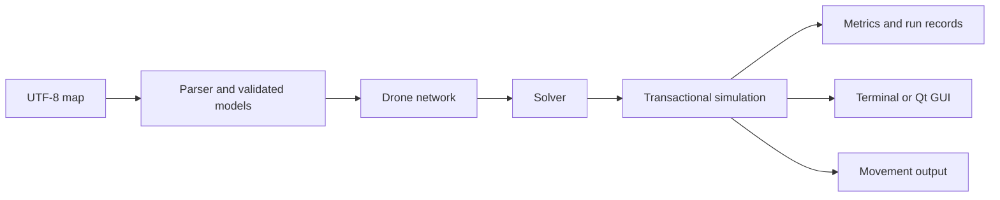

# Fly-In Drones

## Description

Fly-In routes a fleet of drones from one start hub to one destination through a
network with limited hub and connection capacities. The objective is to deliver
all drones in as few discrete turns as possible while respecting simultaneous
movement, restricted zones, and shared bidirectional connections.

The Python implementation provides a proof-required optimal default, a greedy
baseline, four search rungs, an adaptive portfolio, colored terminal feedback, a PySide6 desktop visualizer,
movement files, JSON run records, and repeatable benchmark tools. Graphs,
flow bounds, and searches use the Python standard library rather than a graph
package.

### Simulation model

- Every drone starts at the start hub. Start and goal occupancy is unlimited.
- Regular hubs default to capacity one. Departures free hub capacity during the
  same turn, allowing another drone to arrive immediately.
- Normal and priority hubs take one turn to enter. Restricted hubs take two:
  departure occupies the connection, and arrival follows on the next turn.
- A connection's capacity is shared across both directions. A restricted
  departure claims its connection on the entry turn; arrival releases that slot
  for another departure on the same turn.
- Blocked hubs cannot be entered; blocked endpoints are rejected at simulation
  creation. Waiting is allowed. Delivered drones leave active occupancy.
- Each turn validates all actions and resulting capacities before committing
  positions, traffic, history, and metrics. A drone cannot move twice in a turn.

### Algorithm choices and implementation strategy

#### Default: proved minimum-turn planning (`optimal`)

The default validates a feasible fleet schedule, computes a rigorous native flow
lower bound, and certifies immediately when the two makespans match. Otherwise,
it performs complete makespan-ordered ICBS search within the finite incumbent
horizon. A successful result always carries a minimum-makespan certificate;
physical path cost and priority preference are secondary tie breakers.

Proof mode has no default time or node cutoff (`None`). Caller deadlines and
GUI cancellation remain effective. Explicit `--time-budget` or `--node-budget`
limits may interrupt the proof: the CLI exits nonzero and the GUI leaves
playback disabled, with Reset available. Any retained feasible incumbent is
only diagnostic. Choose `--solver icbs` or another explicit budgeted strategy
when a feasible cutoff result is desired. Complete search can be exponential;
there is no fixed fleet-size restriction or machine-time guarantee.

The preferred-cross-route fixture takes 4 turns with numeric priority planning,
but the default proves and delivers it in 3. A separate regression requires CT
search to prove 5 turns even though its aggregate flow bound is only 4.
See [planning architecture and proof](docs/FLY_IN_ALGORITHMS.md) for the
completeness argument, responsibility owners, state lifetimes and limits.

#### Feasible floor: prioritized reservation planning (`priority`)

Drones are planned sequentially in numeric ID order. Each search operates over
states `(hub, arrival_turn)`, considering both waiting and traversing an edge.
A reservation table records the hub and connection capacity already claimed by
previous drones. Restricted traversal reserves the link-entry slot and the
destination hub at its actual arrival time.

The heap orders candidates by earliest arrival, then lowest accumulated physical
path cost, then fewest entries into nonpriority zones, with stable insertion
order as the final tie breaker. Consequently, priority zones win otherwise
equivalent choices. A state's predecessor changes only when its secondary score
improves, avoiding unnecessary detours from overwritten predecessors.

```text
check that the goal is reachable through accessible hubs
for drone in numeric ID order:
    search (hub, turn) states up to the planning horizon
    consider waiting and traversals that fit existing reservations
    choose earliest arrival, then path cost, then priority preference
    reconstruct the chosen route and reserve its occupied slots
combine all departures into one cached turn schedule
```

The complete schedule is prepared once and then consumed turn by turn. GUI
preparation runs in a cancellable worker before playback; graphics stay on the
GUI thread. The initial horizon is `max(100, 2 * (V + N + 1))` and expands as
needed to admit a serial schedule after earlier drones finish. Python callers
can set an explicit `PriorityBasedSolver(horizon=...)`; exhaustion of an
explicit horizon is distinct from a disconnected destination. Fixed drone
ordering can miss better joint schedules.

This rung is prioritized space-time planning. Its historical class name
`PriorityBasedSolver` remains as an alias for `PrioritizedPlanner`; the separate
`PBSSolver` below implements Priority-Based Search.

#### Baseline: weighted Dijkstra (`greedy`)

The baseline caches a shortest next step and downstream distance for each
encountered source hub. Dijkstra uses entering-zone duration as its weight,
with priority-zone weights multiplied by `0.75`. That discount affects routing
preference only: simulation time and recorded path cost remain physical
one-/two-turn costs.

```text
compute or reuse shortest next steps for available drones
sort candidates by downstream distance, then drone ID
accept moves while current hub/link capacity permits
leave the remaining drones waiting
```

Greedy resolves conflicts locally and conservatively reserves destination space
for restricted departures. It does not search alternative routes around traffic
or plan a complete future schedule. It can deadlock on maps where coordinated
waiting or alternative routing is necessary; the engine reports failure.

#### Solver ladder and adaptive selection

All four rungs use the same capacity-aware `SpaceTimeAStar`. It precomputes
reverse Dijkstra travel-time heuristics, searches `(hub, turn)` states, checks
per-turn hub and bidirectional link capacities, and supports agent-specific
negative hub/link constraints. `ReservationTable` stores sparse counts and can
remove complete paths for repair. A restricted move from state `t` claims its
link at turn `t+1` and its destination hub at turn `t+2`.

| Solver | Mechanism | Result guarantee |
|---|---|---|
| `optimal` (default) | Validated floor, rigorous bounds and complete finite-horizon makespan CT search | Success requires a minimum-turn certificate; interruption is an unproved error |
| `priority` (Rung 0) | Numeric drone order, one pass of space-time A* | Feasible schedule on reachable supplied maps; no general optimality claim |
| `lns` (Rung 1) | Repeatedly remove 2–5 paths and replan in shuffled order; 70% bottleneck-sharing, 30% random neighborhoods | Keeps only strictly better `(makespan, path cost)` incumbents |
| `pbs` (Rung 2) | Depth-first search over an acyclic priority graph; replan lower agents and their descendants against all ancestors | Feasible incumbent on node/time cutoff; no optimality claim |
| `icbs` (Rung 3) | Makespan-ordered constraint tree; classify capacity conflicts, branch on every member of a minimal overcapacity group, and bypass helpful equal-arrival alternatives | Marks makespan optimal only after a complete proof; timeout returns an uncertified feasible incumbent |
| `adaptive` | Profile fleet/graph, run priority floor, 150 ms quick LNS, then ICBS for small instances or PBS/deeper LNS for larger ones | Never worsens the floor; certified lower-bound matches may prove makespan optimal |

LNS repairs commit only a strict lexicographic improvement; rejected repairs
restore every removed reservation. Its selection rule is this project's
adaptation of MAPF-LNS to makespan, not a reproduction of the paper's
sum-of-costs objective. PBS detects cycles with Tarjan's algorithm and
branches on incomparable agents even when a capacity greater than one allows
some sharing. ICBS orders its open constraint tree by a makespan lower bound;
for capacity `c`, it branches on each of `c+1` conflicting agents. Helpful
bypasses keep the parent's constraints. Its `optimal_makespan` flag does not
certify minimum physical path cost among equal-turn schedules.

Adaptive profiling measures `N`, `V`, `E`, `E/V`, restricted-zone ratio, and
a shared-resource minimum cut. It computes a necessary lower bound from
shortest-path latency and a time-window flow relaxation. If a valid schedule
matches that bound, its makespan is proved optimal. The initial feasible floor
may finish after a local improvement deadline; external caller deadlines and
later-stage remaining budgets still apply and explicit GUI cancellation always interrupts work. A
single structured line per adaptive preparation is appended to
`records/run_log.jsonl` (or the chosen records directory), including the map,
winning rung, initial/final makespan and path cost, iterations, elapsed time,
stage statuses, and proof flag.

#### Complexity, caching, and limits

Let `V` be hubs, `E` connections, `N` drones, `H` the per-agent planning
horizon, `T` executed turns, `I` LNS iterations, and `k` agents repaired per
iteration (`2–5`). These are conservative structural bounds rather than
wall-clock promises:

| Component | Time | Additional memory |
|---|---|---|
| Priority preparation | `O(N H (V + E) log(H(V + E)))` conservative bound | `O(H(V + E) + NH)` for search, reservations, and schedule |
| LNS improvement | Up to `I` repairs of at most `k` agents, each with a bounded space-time search | Incumbent paths plus sparse reservations and one search frontier |
| PBS high-level search | Exponential in `N` priority relations in the worst case; each node can replan descendants | Priority DAGs and candidate path sets per search node |
| Optimal / ICBS high-level search | Exponential in conflicts/constraints in the worst case; one low-level search per child | Open constraint tree, per-node paths and constraints |
| Flow lower bound | Repeated native max-flow evaluations over a split graph | Residual graph and BFS frontier |
| Greedy route cache construction | At most `O(V (V + E) log V)` | `O(V + E)` temporary search and `O(V)` cached routes/distances |
| Greedy turn selection | `O(N² + N log N)` due to current drone lookup and sorting | `O(N + V + E)` |
| Simulation state | Linear scans of fleet/edges per turn, plus action validation | `O(V + E + N)` |
| Stored history and drone logs | Proportional to movement events | Up to `O(NT)` |
| GUI scene | Drawing depends on visible items and frame rate | `O(V + E + N)` graphics items |

Priority search reserves only used slots; unsuccessful lookups do not create
empty reservation entries. Network connections have a canonical index. Greedy
caches topology-dependent results for one network; a different network clears
those caches. Neither strategy supports changing topology during a run.

There is no fixed drone-count limit, but larger fleets, horizons, and high-level
search trees increase planning time and memory. Preparation can be cancelled in
the GUI. `Simulation.run(max_turns=...)` offers an optional explicit execution
limit. Benchmark representative maps before using very large fleets. Playback
speed does not change solver decisions.

### Visual representation and user experience

The terminal prints a simple colored network scheme for Turn 0 and every
completed turn, with drone counts directly inside the hubs. Each turn stays in
scrollback. A legend at the beginning maps short hub IDs to names, types, and
capacities. `S` marks start, `G` goal, `H` normal, `P` priority, `R` restricted,
and `X` blocked. For example:

```text
Turn 1 | At hubs 1 | In transit 1 | Delivered 0/2
[S01:1] ....{1->R02}.... [R02:0] ........ [G03:0]
```

`[S01:1]` means one drone at the start. `{1->R02}` means one drone on that
connection heading toward restricted hub R02, arriving next turn. Drones on
connections are excluded from hub counts. Delivered drones are counted in the
header, not in goal occupancy. At-hub + in-transit + delivered equals fleet size.
Connections without a transit label have no drones still in flight, even if
drones crossed them during the completed turn.

Small maps use their coordinates. When projected hubs or transit labels would
overlap, the renderer switches to one connection per line, such as
`[S01:1] --{1->R02}-- [R02:0]`. Repeated IDs identify the same hub; their counts
must not be added together. Isolated hubs are shown too. No hubs or counts are
merged or omitted to fit the screen. Every connection is bidirectional; the
arrow in a transit label indicates the drones' destination. Diagram crossings
do not create additional connections.

`--display compact` retains brief movement/progress output, `full` adds textual
hub/link occupancy, and `moves` provides plain machine-readable lines.
Configured colors distinguish destinations without changing routing semantics;
type labels and explicit counts also work with `--no-color`.

The desktop view uses Qt Widgets and vector graphics, without a browser or an
OpenGL viewport. It provides:

- Distinct start/goal shapes, type markings, configured colors, and a dark theme
  so important hubs remain identifiable without relying only on color.
- Normalized coordinates with an upward-positive map axis, pan/zoom, bounded
  grid rendering, and Fit for maps with negative or large coordinates.
- Quadcopter markers with upright IDs and directional headings. Stable adaptive
  rings spread crowded fleets around hubs and connection midpoints.
- Animated hub-to-hub movement. Restricted movements visibly stop halfway on
  their first turn and arrive on the second, making link occupation explicit.
- Hover tooltips and a pinned, movable Inspector showing coordinates, zone type,
  capacity, live occupants, link traffic this turn, and drones still in transit.
- A delivered-fleet progress bar and turn/metric summaries. A loaded map starts
  paused at Turn 0, allowing inspection before launch.

Animation uses eased interpolation. Smooth playback targets typical desktop
refresh rates; 60 FPS is not guaranteed on every display or workload. Qt controls
the animation callback frequency. [Qt animation framework](https://doc.qt.io/qt-6/qabstractanimation.html)

### Object responsibilities

`NativeDijkstra` owns routing mechanics with explicit scoring dependencies.
`NetworkProfiler` owns physical/priority route analysis and native flow;
`ResourceWindow` expresses aggregate resource budgets. `ConflictDetector` owns
capacity violations, `SeedPlanner` composes a floor planner and path validator,
and `ConflictAssessment` owns repeatable split classification. Each solve binds
these objects to one unchanged network. A* caches distances and transitions only
for that solve; greedy's `WeightedRoutePlanner` uses its separate weighted
policy and is recreated for a new network. No mutable analysis is shared between
GUI workers.

`SolverFactory` supplies the canonical default and fresh strategies.
`CliApplication`, `DesktopApplication`, and benchmark application objects own
workflows; their entry functions are thin adapters. `AtomicFileWriter` owns a
destination's atomic replacement, while `RunSession` owns run finalization.
See [architecture](docs/FLY_IN_ALGORITHMS.md) and the
[verification report](docs/COMPLIANCE_REPORT.md).

### Project structure



| Location | Responsibility |
|---|---|
| `src/fly_in/parser.py`, `models.py`, `errors.py` | Syntax, configuration models, readable input errors |
| `src/fly_in/realm/` | Zones, connections, drones, adjacency and connection indexes |
| `src/fly_in/solvers/` | Network-bound analysis, timed paths, validation, exact proof search and explicit heuristics |
| `src/fly_in/solver_factory.py`, `provenance.py` | Canonical default/construction and immutable planning evidence |
| `src/fly_in/simulation.py` | Turn validation, simultaneous movement, history |
| `src/fly_in/metrics.py`, `runs.py`, `output.py` | Measurements, provenance, atomic persistence |
| `src/fly_in/cli.py`, `benchmark.py`, `visualization/` | CLI workflows, benchmarking, terminal rendering |
| `src/fly_in/gui/` | Main-window lifecycle, map catalog, canvas/items, theme, inspector, animation |
| `maps/` | Provided `.txt` maps grouped by difficulty |
| `tests/` | Parser, routing, simulation, persistence, CLI, and offscreen GUI regressions |
| `scripts/` | Comparative benchmarks, bound analysis, time/memory profiling |
| `out/`, `records/` | Generated movement files, JSON reports, adaptive JSONL log |

### Answers to the subject's ten questions

1. **How efficient is the algorithm?** The default meets every supplied target
   and solves the challenger in 43 turns. Its preparation cost grows with fleet,
   graph, and horizon size; turn count and computation time are separate metrics.
2. **Can it work with a large number of drones?** Yes, within available time and
   memory. Sequential reservations and stored history grow with fleet size;
   there is no claim of unlimited scale. See the bounds and safeguards above.
3. **What is its complexity?** Priority preparation has the conservative bound
   `O(N H (V + E) log(H(V + E)))`; greedy has cached Dijkstra setup followed by
   `O(N² + N log N)` selection per turn. PBS/ICBS have exponential high-level
   worst cases. Symbols and memory costs are defined above.
4. **Are paths recalculated or cached?** Priority prepares and caches the whole
   schedule once. Greedy caches static next steps/distances, but reevaluates
   capacity conflicts on each turn.
5. **How does it affect memory?** Reservations/search scale with the time-expanded
   graph, while schedules and history scale with fleet and duration. Graphics
   add persistent items for the topology and fleet; no frame images are stored.
6. **How do visuals enhance understanding?** Shapes, colors, headings, midpoint
   stops, occupancy inspection, and stepping expose routing and capacity choices
   that are harder to follow in a movement-token stream.
7. **Does it meet the benchmarks?** The default passes all ten supplied maps,
   including the optional challenger. The table below gives reproducible results.
8. **How does it compare to reference targets?** It beats all nine mandatory
   turn targets, including circular loop at 10 versus 15, and reaches 43 on
   the challenger against the strict target of less than 45.
9. **What optimizations were implemented?** Indexed connections, cached static
   greedy routes, a reusable priority schedule, sparse reservation lookup,
   reachability checking, and correct predecessor/tie handling. Removing
   unnecessary detours reduced hard-map path costs without increasing turns.
10. **Can it beat the challenger record?** Yes: 43 turns. The first possible
    delivery takes 19 turns, and all 25 drones must cross the final capacity-one
    connection. Therefore `19 + 24 = 43` is a lower bound for this supplied map.
    The measured schedule reaches it; this is a map-specific optimality argument.

## Instructions

### Installation

Use Python **3.10 or newer**, [uv](https://docs.astral.sh/uv/getting-started/installation/),
and Make. Run commands from the repository root:

```sh
make install
make run
```

`make install` runs `uv sync`, creating or synchronizing `.venv` from the project
and lockfile. `uv run` also synchronizes the environment as needed, so `make run`
can create it. No manual activation or separate compilation step is required.
Dependencies include Pydantic, Rich, and PySide6; development dependencies include
pytest, mypy, and flake8. First installation requires dependency download access.

The GUI requires a desktop display and Qt's platform libraries. Terminal mode
works without opening a display. Under WSL, use a working WSLg/display setup for
the desktop GUI; use terminal mode when that is unavailable.

### Execution and CLI options

With no map supplied, `make run` prompts for one `.txt` map recursively discovered
under `maps/`, then offers Terminal or GUI. A direct map defaults to terminal.
Noninteractive invocation requires an explicit map path.

```sh
make run ARGS="maps/easy/01_linear_path.txt"
uv run fly-in maps/medium/03_priority_puzzle.txt --solver greedy
uv run fly-in maps/easy/01_linear_path.txt --validate
uv run fly-in maps/hard/01_maze_nightmare.txt --gui
make gui
```

`make gui` opens the desktop map library without terminal prompts. Select and
load a map, then press Start.

| Argument | Meaning/default |
|---|---|
| `config` | Optional map path; prompt when omitted in an interactive terminal |
| `--solver optimal\|priority\|greedy\|lns\|pbs\|icbs\|adaptive` | Routing strategy; default `optimal` |
| `--time-budget SECONDS` | Explicit proof deadline for optimal; otherwise local improvement budget. Optimal defaults unlimited; heuristic factory defaults 1 second |
| `--seed INTEGER` | Reproducible LNS neighborhood seed; default 0 |
| `--max-iter INTEGER` | Maximum LNS repairs; default 200 |
| `--node-budget INTEGER` | Maximum CT/priority nodes. Optimal defaults unlimited; explicit PBS/ICBS defaults 10000 |
| `--gui`, `--terminal` | Mutually exclusive mode selection |
| `--validate` | Parse and validate configuration, without solving or opening GUI |
| `--display visual\|compact\|full\|moves` | Terminal detail; default `visual` |
| `--no-color` | Disable terminal colors; does not change the GUI palette |
| `--map-root PATH` | Map library and relative output mapping; default `./maps` |
| `--output-dir PATH` | Movement output root; default `./out` |
| `--records-dir PATH` | Run JSON root; default `./records` |
| `-h`, `--help` | Show usage |

`--validate` takes precedence over execution mode; it checks configuration, not
whether a solver can finish a map. Terminal display flags affect terminal mode.
Paths default to the current working directory, not the installed package.

To capture exact movements, use the application entrypoint directly; Make may
echo its command:

```sh
uv run fly-in maps/easy/01_linear_path.txt --display moves > movements.txt
```

Movement-only stdout has no color or status decorations. Prompts and completion
summaries go to stderr. Library discovery uses `.txt` files; `.map` files are not
required.

### Map format and a complete example

Maps are UTF-8 text. Blank lines are ignored; `#` starts a comment, including
inline comments. The first noncomment line is `nb_drones: <positive_integer>`.
Define exactly one start and goal, unique hub names without whitespace or dashes,
and integer coordinates. Declare a connection after both of its hubs exist;
reverse duplicates and self-connections are rejected.

Metadata is one trailing bracket block containing space-separated `key=value`
pairs in any order. Zones accept `zone`, `color`, and `max_drones`; connections
accept `max_link_capacity`. Unknown or duplicate metadata keys are errors.

| Setting | Default and behavior |
|---|---|
| `zone` | `normal`; alternatives: `priority`, `restricted`, `blocked` |
| `max_drones` | Positive integer, default 1; ignored on start/goal |
| `max_link_capacity` | Positive integer, default 1; shared bidirectionally |
| `color` | Optional single-word color; unknown renderer colors fall back safely |

Named colors such as `orange` are portable between renderers. `#` is reserved for
comments, so hexadecimal `#RRGGBB` literals are not supported by this grammar.

Save this as `example.txt`:

```text
nb_drones: 2
start_hub: base 0 0 [color=green]
end_hub: goal 2 0 [color=gold]
hub: sensor 1 0 [zone=restricted max_drones=1 color=orange]
connection: base-sensor
connection: sensor-goal
```

Run:

```sh
uv run fly-in example.txt --display moves
```

Expected stdout, verified with the default solver:

```text
D1-base-sensor
D2-base-sensor D1-sensor
D1-goal D2-sensor
D2-goal
```

Each line is one turn. `D<ID>-<hub>` indicates arrival; a restricted departure
uses `D<ID>-<connection>`, with connection endpoints in canonical sorted order.
Waiting drones have no token, and an entirely idle turn is an empty line.
Delivered drones no longer appear. Here D1 arrives at turn 3 and D2 at turn 4:
4 turns, 6 movement events, total physical path cost 6, average 1.5 events/turn,
and average delivery turn 3.5. D2 enters the connection when D1 leaves it.

Errors include source lines and causes where available: `nb_drones: 0` reports
that the count must be positive; a connection to an undeclared hub identifies
the missing hub; malformed UTF-8 is reported as a readable file error.

### Output files and metrics

A successful run atomically replaces `out/<category>/<map>.txt`. Files outside
`--map-root` use `out/external/<path-hash>/<filename>` to distinguish identical
filenames from different directories. Failed or cancelled runs do not replace
the last successful movement file.

CLI and GUI share run finalization and write a timestamped JSON record under
`records/`. It includes schema version, unique run ID, timestamps, map path and
SHA-256, solver and parameter metadata, status/error, metrics, movement history,
planning duration, and completed output path. Its separate `planning` object
contains `optimal_makespan`, planning `status`, `proof_reason`, `lower_bound`,
and `achieved_makespan`. Execution `status` remains completed/failed/cancelled;
a proved plan can still be cancelled during playback. Repeated finalization of the same
session returns the same artifacts.

| Metric | Definition |
|---|---|
| `turns` | Executed simulation turns |
| `total_moves` | Movement events; restricted departure and arrival each count |
| `average_moves_per_turn` | Events divided by executed turns; zero for no turns |
| `total_path_cost` | Physical entering-zone costs, charged once per departure |
| `arrival_turns` | First goal arrival turn for each delivered drone |
| `average_turns_per_drone` | Mean recorded arrival turn, including waiting at start |
| `planning_duration_seconds` | Preparation time for a preparable solver, excluding GUI playback |

Partial-run averages include only drones delivered so far; empty arrival sets
produce zero. Greedy routing happens during stepping, so its preparation-duration
field does not measure all routing work. Benchmark total duration includes the
whole map run. Playback speed and wall-clock time never change turn/path metrics.

### GUI controls

| Control | Action |
|---|---|
| Start / Resume / Pause; Space | Begin, continue, or suspend playback |
| Step; Right arrow | Advance exactly one animated turn |
| Reset; R | Cancel current playback/preparation and restore Turn 0 |
| Fit; F | Fit map, labels, and fleet extents in the view |
| Inspector | Reopen the inspection pane, retaining its selected hub or link |
| Speed | 100–2000 ms per turn, default 500; right is faster, left is slower; applies to the next turn |
| Click hub/link | Pin live details in the Inspector |
| Hover | Inspect tooltip without changing pinned selection |

Pause suspends an active interpolation. Reset, loading another map, or changing
map libraries cancels the old session and prevents stale worker results from
replacing the new map. Reset retains the selected solver. Completed runs save
automatically, and the control state shows completion.

### Minimum-turn bounds for a map

From the repository root, substitute your map path:

```sh
uv run python scripts/analyze_bounds.py maps/challenger/01_the_impossible_dream.txt
# Add --json for machine-readable results.
```

`lower_bound` is a proven lower bound on the minimum turns any legal schedule
needs, and can be smaller than the true optimum. A legal schedule finishing in
exactly that many turns proves optimality, but this analyzer does not construct
that schedule.

### Benchmarks and development checks

```sh
uv run fly-in benchmark --solver optimal
uv run fly-in benchmark --solver priority
uv run fly-in benchmark --solver greedy
uv run fly-in benchmark --solver icbs --time-budget 1.0
uv run fly-in benchmark --map-root maps --records-root records
make benchmark
make benchmark ARGS="--solver adaptive"
uv run python scripts/benchmark_ladder.py --time-budget 1.0 --export-markdown
uv run python scripts/analyze_bounds.py maps/challenger/01_the_impossible_dream.txt
uv run python scripts/profile_solvers.py maps/hard/03_ultimate_challenge.txt --time-budget 0.2
make lint
make lint-strict
QT_QPA_PLATFORM=offscreen uv run pytest -q
```

The benchmark command defaults to proof-required `optimal`, supports every
solver and its time/iteration/node controls,
`--map-root`, `--records-root`, and `--help`. It runs each `.txt` map, reports
turns/path cost against known targets, and saves a timestamped JSON report with
environment and map fingerprints. `make benchmark` runs the six comparison
strategies (excluding proof-required `optimal`) and
prints turns/path costs; pass `ARGS="--solver adaptive"` to select one. The
script also accepts `--solver` directly and exports a combined JSON report and
optional Markdown table.
`analyze_bounds.py` reports a necessary makespan bound from path latency and
shared-resource flow. `profile_solvers.py` records planning time, search
expansions, and Python allocation peaks measured by `tracemalloc`.
It returns a nonzero exit status for a failed run or missed known target.
Benchmarking does not overwrite the normal per-map movement output.

Measured on 3 October 2026 with Python 3.10.21 under WSL2, using a one-second
budget for each improvement rung. Each cell is `turns / physical path cost`.
On these ten maps, LNS, PBS, ICBS, and Adaptive each returned exactly the same
objective as Rung 0; this is a measured tie, not a claimed general equivalence.

| Map | Target | R0 | LNS | PBS | ICBS | Adaptive | Greedy |
|---|---:|---:|---:|---:|---:|---:|---:|
| Easy: linear | ≤6 | 4/6 | 4/6 | 4/6 | 4/6 | 4/6 | 4/6 |
| Easy: fork | ≤8 | 4/12 | 4/12 | 4/12 | 4/12 | 4/12 | 6/12 |
| Easy: capacity | ≤6 | 4/12 | 4/12 | 4/12 | 4/12 | 4/12 | 4/12 |
| Medium: dead end | ≤12 | 8/20 | 8/20 | 8/20 | 8/20 | 8/20 | 8/20 |
| Medium: circular | ≤15 | 10/30 | 10/30 | 10/30 | 10/30 | 10/30 | 10/30 |
| Medium: priority | ≤12 | 6/22 | 6/22 | 6/22 | 6/22 | 6/22 | 8/20 |
| Hard: maze | ≤30 | 13/48 | 13/48 | 13/48 | 13/48 | 13/48 | 13/48 |
| Hard: capacity | ≤35 | 16/60 | 16/60 | 16/60 | 16/60 | 16/60 | 16/60 |
| Hard: ultimate | ≤45 | 26/180 | 26/180 | 26/180 | 26/180 | 26/180 | 26/180 |
| Challenger | <45 | 43/475 | 43/475 | 43/475 | 43/475 | 43/475 | 67/475 |

The flow analyzer returns a 43-turn lower bound for Challenger; its valid
43-turn schedule proves optimal makespan there. It returns bounds equal to the
R0 makespans for all ten supplied maps. In the measured one-second run, PBS
reached its time limit on several larger maps and kept the feasible floor;
ICBS and Adaptive certified the matching flow bound without needing a full
constraint-tree search on those maps.
No solver is claimed to minimize path cost among schedules with the same
makespan. Greedy misses the Challenger target. Absolute runtime and cutoff
outcomes depend on the machine; use the saved JSON reports and map hashes when
comparing runs.

| Make target | Behavior |
|---|---|
| `install` | `uv sync` |
| `run` | Execute `python -m fly_in`; pass CLI arguments through `ARGS` |
| `gui` | Open the desktop map library |
| `debug` | Run the CLI under `pdb`; accepts `ARGS` |
| `benchmark` | Compare six heuristic strategies; accepts `ARGS`, such as `--solver icbs` |
| `lint` | flake8 and the subject's required mypy flags |
| `lint-strict` | flake8 and strict mypy |
| `clean` | Remove caches, bytecode, build and coverage artifacts; keep `.venv`, maps, outputs, records |

Tests cover parsing and errors, capacity timing, duplicate/transactional actions,
solver objectives, supplied-map performance, persistence, CLI behavior, and
headless GUI components/lifecycle. Offscreen checks verify behavior but cannot
establish animation smoothness or graphics-driver stability on a particular
laptop.

### Troubleshooting runtime failures

- **No maps found:** run from the repository root or pass `--map-root PATH`.
  Check that the directory contains `.txt` files, including nested categories.
- **Missing environment or command:** run `make install`, then use `uv run fly-in`.
  The bare command is available only when `.venv/bin` is on your PATH.
- **Dependency installation fails:** check network access and supported Python/
  platform packages. These failures happen before simulation begins.
- **GUI cannot connect to a display:** use a working desktop/WSLg session or
  `--terminal`. `QT_QPA_PLATFORM=offscreen` is intended for tests.
- **Unwritable output location:** choose writable `--output-dir` and
  `--records-dir`; no records are written into the installed package directory.
- **Planning unproved:** increase/remove explicit proof limits, or select an
  explicit budgeted solver for a feasible result. Reset remains available.
- **Disconnected map, horizon exhaustion, or deadlock:** inspect blocked zones,
  connections, and capacities.

## Resources

### Algorithms and implementation references

#### Academic sources
- [Boyarski, Felner, Stern, Sharon et al., "ICBS: Improved Conflict-Based Search"](https://www.ijcai.org/Proceedings/15/Papers/110.pdf) (IJCAI 2015):
  classify conflicts as cardinal/semi-cardinal/non-cardinal and resolves cardinal ones first, with "bypassing" a conflict without branching when possible.
- [E. W. Dijkstra, *A note on two problems in connexion with graphs* (1959)](https://ir.cwi.nl/pub/9256/9256D.pdf):
  the classic shortest-path algorithm underlying weighted routing.
- [Fejziaj, Hassona, & Marszalek, "On dynamic multi-agent pathfinding methods: review, simulations and modifications"](https://arxiv.org/abs/2606.03735) (2026):
 A recent survey on WHCA*'s mechanics, with an accessible explanation, useful to read if Silver's paper (cited below) on Cooperative Pathfinding is difficult to follow from start.
- [Li, Chen, Harabor, Stuckey & Koenig, "Anytime Multi-Agent Path Finding via Large Neighborhood Search"](https://www.ijcai.org/proceedings/2021/0568.pdf) (IJCAI 2021):
  the destroy-and-repair loop: start from any fast feasible solution, repeatedly replan a random small subset of agents, keep improvements, set the time budget to decide how far you get.
- [Ma, Harabor, Stuckey, Li & Koenig, "Searching with Consistent Prioritization for MAPF"](https://ojs.aaai.org/index.php/AAAI/article/view/4758) (AAAI 2019):
  Priority-Based Search: instead of fixing one priority ordering upfront, searches the space of orderings via a depth-first priority tree, backtracking on conflicts.
- [David Silver, *Cooperative Pathfinding* (2005)](https://cdn.aaai.org/ojs/18726/18726-52-22369-1-10-20210928.pdf):
  space-time search and reservation-table background for prioritized planning.
- [Sharon, Stern, Felner & Sturtevant, "Conflict-Based Search for Optimal MAPF"](https://cris.iucc.ac.il/en/publications/conflict-based-search-for-optimal-multi-agent-path-finding-27/) (AAAI 2012 / Artificial Intelligence 219, 2015):
  two-level search: plan agents independently, then resolve detected conflicts via a constraint tree.
- [Sigurdson, Bulitko, Koenig, Hernandez, & Yeoh, "Automatic Algorithm Selection in Multi-Agent Pathfinding"](https://arxiv.org/pdf/1906.03992):
  choosing a portfolio of Multi-Agent Pathfinding (MAPF) algorithms based on instance.

#### Docs
- [Python `heapq`](https://docs.python.org/3/library/heapq.html):
  heap-based search queues and stable tie-breaking patterns.
- [Qt for Python documentation](https://doc.qt.io/qtforpython-6/):
  Widgets, graphics scenes, signals, and worker-thread ownership.
- [Qt `QVariantAnimation`](https://doc.qt.io/qtforpython-6/PySide6/QtCore/QVariantAnimation.html):
  eased interpolation and animation state controls.
- [Rich documentation](https://rich.readthedocs.io/en/stable/):
  terminal colors, styled text, and benchmark tables.
- [Pydantic models](https://docs.pydantic.dev/latest/concepts/models/):
  typed configuration models and validation errors.
- [uv project guide](https://docs.astral.sh/uv/guides/projects/):
  synchronized environments, lockfiles, and project execution.

### AI assistance

- Understanding algorithms to code the greedy and priority-based solvers
- Discussing the whole project's design, separation of visualization from core simulation and output
- Test and benchmark scripts' code
- GUI implementation (QT-based GUI)
- Map profiler code (checking least possible turns for a valid solution)
- Drafting this README
